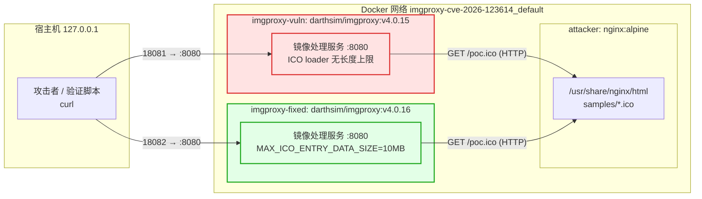
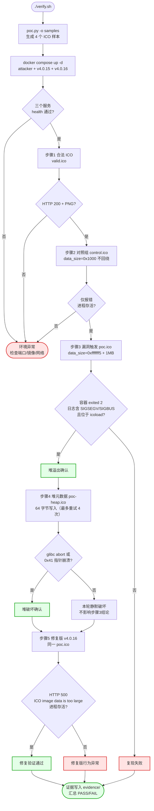
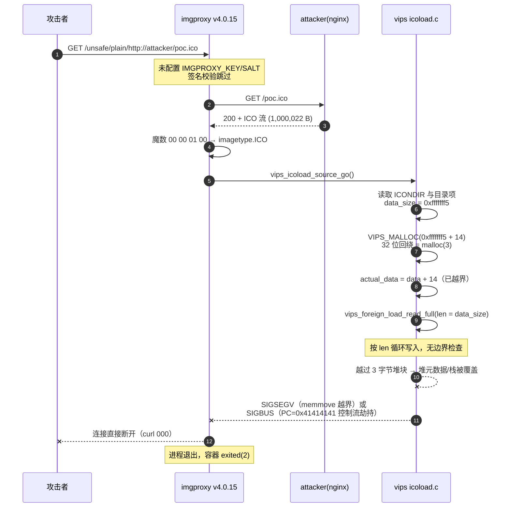
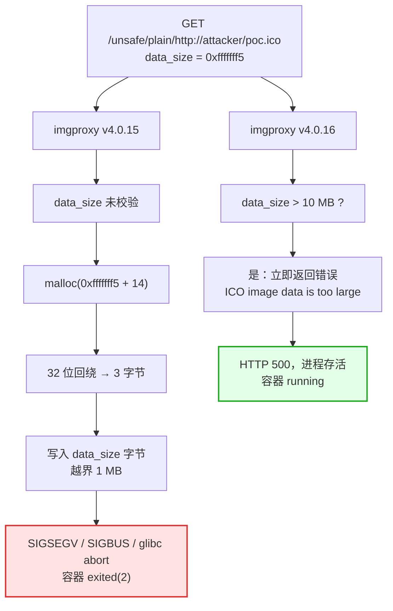
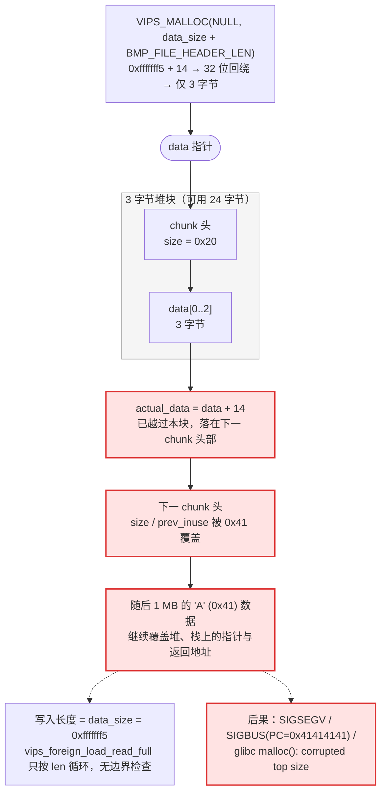

# GHSA-hff9-5pqw-6w9f 复现架构（Mermaid）

> 配套文件：`docker-compose.yml`、`poc.py`、`verify.sh`、`README.md`
> 渲染方式：GitHub / GitLab / VS Code(MMD) / Obsidian 原生支持；或 `npx @mermaid-js/mermaid-cli -i architecture.md -o out`。

## 1. 部署架构（Docker Compose）

## 2. 复现流程（verify.sh）

## 3. 漏洞触发时序（v4.0.15）

## 4. 同一请求在两个版本上的差异

## 5. 堆内存布局（溢出点）

